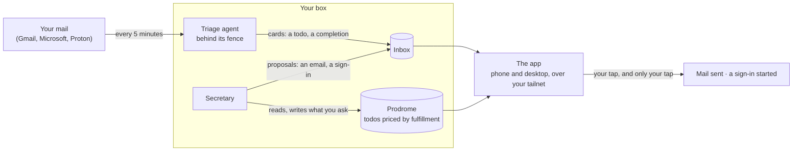

# Suzatary

A secretary you run on your own machine. It reads your mail, keeps your todos,
and drafts what should be sent — and nothing it writes leaves the machine until
you tap it on your phone.

  
  &nbsp;
  

Every todo carries a **fulfillment**: a number in `[0, 1]` that says, as a
function of time, how well it is being met. A deadline that is close and that
hurts to miss reads low; an errand that can wait reads high. The list is
sorted by it, so the top of your list is what matters most *now*. Todos live
on a [Prodrome](https://github.com/fulfilium/prodrome), a small
content-addressed database whose history is a grow-only set of objects, so
every device holds a full replica, writes offline, and converges by union.

## Who it is for

- **A person who wants an assistant over their own mail** and will not hand
  their inbox to a hosted service. You need a small Linux box that is always
  on, [Nix](https://nixos.org), a [Tailscale](https://tailscale.com) network
  for your box and your phone, and a Claude subscription.
- **Someone curious about local-first applications** built as readings of a
  CRDT: every page is a pure function of the replica it holds, every cache is
  a memo of a pure function, and every effect is an intent the history
  eventually subsumes.

It serves one person per deployment, and it is young (see
[what is still rough](#what-is-still-rough)).

## How it works

1. **Mail is synced** every five minutes, plus a push wake for IMAP accounts.
2. **The triage agent** reads each new message and writes what it implies —
   a new todo, a change of deadline, a completion — as a *card in your Inbox*.
   Nothing reaches your todos until you tap the card. It runs behind a fence
   that permits only Suzatary's own verbs, and it has no way to send, sign in
   or reach the network.
3. **The secretary** reviews the agent's cards: it withdraws duplicates and
   noise and leaves the rest for you, with its reasons. It is also the
   conversation you have in the app.
4. **The app** reads the store. It is a web app you open on your phone or
   desktop over your tailnet, with an optional Android portal. Your writes are
   sealed on the device and synced; the box verifies every object it adopts.
5. **Anything outward** — sending an email, starting an account sign-in,
   storing a secret — is a *proposal* in the Inbox, shown with every field
   and the reasons behind it. It happens when you tap it, and not otherwise.

  

  

The pictures are of the test suite's fixture deployment, taken with its
browser client: Ada and her made-up correspondents, never a real person.
`scripts/web-e2e.sh shots` photographs every page at both widths and in both
themes.

## The safety model

The triage agent reads mail written by strangers, so an injected email is the
threat this design starts from. At worst it can mis-triage or write bad todo
text; it cannot reach a shell, the network, a credential or the outside world.
Each of those is a mechanism, not a rule someone must remember:

- **Capability records.** Every effect is a trait, and each role gets a
  record of the effects it may use. The agent's record has no field that
  sends, so a send verb for it would not compile. The verb list is closed and
  snapshotted in a test.
- **The fence.** The agent runs under a hook that denies every tool except
  Suzatary's own verbs, including tools that do not exist yet: deny by
  default, never a blocklist.
- **Provisional writes.** What the agent writes is a card in your Inbox, and
  nothing reaches a chain until you tap it. Its record holds its chain as a read-only
  store, with no write reachable from it. The fold keeps both readings of older agent text:
  what is believed and what was merely claimed.
- **The tap.** Only a request from a named login on your tailnet, carrying
  the browser's anti-forgery headers, can turn a stored proposal into an
  act. The tap carries an index, never a body, so what is sent is exactly
  what you were shown. The box's own shell and the agent arrive over
  loopback, which can never tap.
- **The closed Typst world.** Every piece of text anyone writes — you, the
  secretary, the agent — is Typst markup, compiled in a world with no HTML
  element, no plugin, no file, no package and no clock, killed after a few
  seconds, and checked by a tripwire before the browser shows it.

[`SECURITY.md`](SECURITY.md) says how to report a vulnerability, and
[`CLAUDE.md`](CLAUDE.md)'s *Containment* and *Irreversibles* sections are
the full threat model.

## Quick start

What you need: a box running [NixOS](https://nixos.org/download) (flakes on),
[Tailscale](https://tailscale.com) on the box and your phone, and a Claude
subscription.

Setting up is a series of commands, each with a check of what it must print:
[`AGENT.md`](AGENT.md) holds them, written for a coding agent working on your
box and just as readable by you. The guide,
[`docs/guide/guide.typ`](docs/guide/guide.typ) (rendered to HTML and PDF by
`nix build .#docs`), tours a demo deployment and explains each part of it. It
shows the same commands, but AGENT.md's checked steps are the ones to follow.

`init` writes `instance.toml`, the one file that makes a deployment yours,
begins your stores, and prints what only you can do next: the model's token
typed at `secretspec`'s prompt and your account's sign-in. No secret is ever
an argument. The app answers only on your tailnet, to the logins you named;
there is no login page and no public endpoint, by design.

### What is still rough

- **Mail setup is by hand**, once per account and per provider: Gmail through
  lieer, Microsoft through a device-code sign-in, Proton through its Bridge.
- **The deployment assumes NixOS** and systemd user units; elsewhere you run
  the same flake outputs under your own scheduler.
- **One person per deployment**, reached only over a tailnet. There is no
  login page by design, and no public endpoint.
- **Most of `docs/` is design plans, dated and written to the project's
  owner.** Each records why a part is the way it is, in the words used when
  it was decided. [The guide](docs/guide/guide.typ) and this page are the
  parts written for you; [`docs/README.md`](docs/README.md) says which is
  which.
- **The Android portal** is built by Nix but signed by you, with your own
  keystore and, for push, your own Firebase project.

## The pieces

| | |
|---|---|
| `app/` | The Rust workspace: `core` (meaning, no I/O), `io` (the interpreters), `cli` (the one binary), `wasm` (the same core for the browser), `plugin` (WebAssembly plugins) |
| `web/` | The TypeScript app: no framework, no npm, one esbuild bundle |
| `android/` | The portal: a WebView onto your box, holding nothing |
| `nix/` | The NixOS module and the service derivations |
| `scripts/` | The operator's shell, the merge gate, the tests' drivers |
| `*.typ` | The Typst documents and templates |
| `OPERATOR.md`, `SECRETARY.md` | The triage agent's and the secretary's manuals |

[`docs/README.md`](docs/README.md) is the map of the documentation:
[`CLAUDE.md`](CLAUDE.md), the project's constitution, and
[`docs/ARCHITECTURE.md`](docs/ARCHITECTURE.md) first.

## Built on

- **[Prodrome](https://github.com/fulfilium/prodrome)** — the database: a
  temporal, content-addressed event store with fulfillment semantics, its
  laws tested in its own repository. Its `SPEC.md` is the contract.
- **[typst-design](https://github.com/bmabsout/typst-design)** — the design
  system: the documents' template, the marks and the colour ramps the app's
  tokens are sampled from.
- **[Typst](https://typst.app)** — every page you read, compiled on the box
  or in your browser.

## Contributing

[`CONTRIBUTING.md`](CONTRIBUTING.md): the gate a change passes, the rule
that a change lands as a series of small commits, and the style guides.

## License

Either the Apache License, Version 2.0 ([LICENSE-APACHE](LICENSE-APACHE)) or
the MIT license ([LICENSE-MIT](LICENSE-MIT)), at your option.
